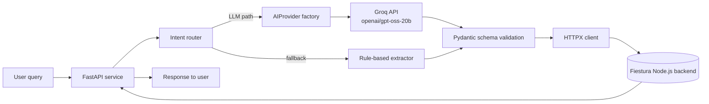

# AI Event Assistant (AI-Fiestura)

A Python **FastAPI microservice** that adds conversational event discovery to [Fiestura](https://github.com/akshanshy/fiestura), my full-stack event management platform. It takes a natural-language query, uses an **LLM (Groq)** to turn it into structured search filters, and fetches matching events from the Fiestura Node.js backend.

> Fiestura live demo: https://fiestura.vercel.app

---

## ✨ Features

- **Natural-language event search**: ask for events in plain English instead of filling in filters
- **Structured intent extraction**: the LLM output is validated against **Pydantic** schemas, so the service never passes free-form text downstream
- **Pluggable LLM provider**: an `AIProvider` abstraction with the **Factory Pattern** lets the provider be chosen through environment variables
- **Rule-based fallback**: if the LLM path isn't used or fails, a rule-based intent extractor still handles the query
- **Service-to-service integration**: events are retrieved from the Fiestura Node.js backend over **HTTPX**
- **Tested**: 17 Pytest cases covering API health, chat validation and event search, all passing
- **Containerized**: ships with a Dockerfile

---

## 🧱 Architecture



1. The user sends a chat message to the FastAPI service.
2. The intent router sends it to the LLM provider (or the rule-based extractor) to extract structured search intent.
3. The result is validated with Pydantic.
4. The service queries the Fiestura backend over HTTPX and returns the matching events.

---

## 🛠️ Tech Stack

| Area | Tools |
|---|---|
| Language | Python |
| API framework | FastAPI |
| Validation | Pydantic |
| HTTP client | HTTPX |
| LLM | Groq API (`openai/gpt-oss-20b`) |
| Testing | Pytest |
| Packaging | Docker |
| Design pattern | Factory Pattern, provider abstraction |

---

## 📁 Project Structure

```
AI-fiestura/
├── app/              # FastAPI application (routes, intent extraction, providers)
├── tests/            # Pytest test suite
├── docs/             # Project documentation
├── Dockerfile
├── requirements.txt
└── README.md
```

---

## 🚀 Getting Started

### Prerequisites

- Python 3.10+
- A [Groq API key](https://console.groq.com/)
- A running Fiestura backend (or its deployed URL)

### Installation

```bash
git clone https://github.com/akshanshy/AI-fiestura.git
cd AI-fiestura
python -m venv venv
source venv/bin/activate        # Windows: venv\Scripts\activate
pip install -r requirements.txt
```

### Configuration

Create a `.env` file in the project root (never commit it):

```env
GROQ_API_KEY=your_groq_api_key
AI_PROVIDER=groq                      # selects the provider through the factory
FIESTURA_API_URL=http://localhost:5000  # base URL of the Fiestura Node.js backend
```

### Run locally

```bash
uvicorn app.main:app --reload
```

The interactive API docs are then available at `http://localhost:8000/docs`.

### Run with Docker

```bash
docker build -t ai-fiestura .
docker run --env-file .env -p 8000:8000 ai-fiestura
```

---

## 🔌 API

| Method | Endpoint | Description |
|---|---|---|
| `GET` | `/health` | Service health check |
| `POST` | `/chat` | Takes a natural-language message and returns matching events |

See `/docs` (Swagger UI) for the full request and response schemas.

---

## 🧪 Tests

```bash
pytest
```

The suite has **17 tests** covering API health, chat input validation and event search. Rule-based intent extraction and the provider router are tested separately from the live LLM call.

---

## 🧠 Design Notes

- **Why Pydantic schemas?** LLM output can be inconsistent. Validating it against a schema means the rest of the service only ever sees well-formed filters.
- **Why an `AIProvider` abstraction?** The app depends on an interface, not on Groq. Swapping or adding a provider is a configuration change plus one new class, with no changes to the routing logic.
- **Why a rule-based fallback?** The service still returns useful results when the LLM isn't available, which also makes tests deterministic.

---

## 🔭 Possible Improvements

- Streaming responses
- Conversation memory across messages
- Response caching for repeated queries
- Rate limiting and request logging

---

## 👤 Author

**Akshansh Yadav**
[Portfolio](https://akshanshyadav.vercel.app/) · [LinkedIn](https://www.linkedin.com/in/akshansh-yadav-b82a73189) · [GitHub](https://github.com/akshanshy)
